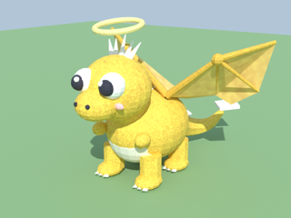

# Dragon Egg Heist 🐉🥚

A Roblox "grab and grow" game. Run into the valley, grab dragon eggs, carry them
home before the Elder Dragon's fire wave sweeps the valley, hatch them into baby
dragons that earn gold, steal dragons from other castles, and rebirth.



## Why this game (research notes)

The biggest Roblox games of 2025–2026 (Steal a Brainrot, Grow a Garden, Escape
Tsunami for Brainrots, Steal an Egg) share one loop:

1. **Go out and grab something.** The farther you go, the rarer it is.
2. **Bring it back to your base.** There it makes money every second.
3. **Spend money on speed/capacity** so you can reach rarer stuff.
4. **Rebirth** to reset with a permanent bonus.

They add tension with **a timed hazard** (tsunami waves) and **player stealing**
(bases you can lock for a short time). Sessions are short (Steal a Brainrot
averages about 3.5 minutes), so the first minute has to pay off fast. That's
why new players get a free dragon and a guided first run.

Dragon Egg Heist uses that loop with a less meme-heavy theme:

| Loop step | In this game |
|---|---|
| Go out and grab | 7 valley zones: Sunny Meadow (Common) → Pinewood → Crag Hills → Ember Wastes → Frost Peak → Void Rift (Mythic) → Dragon's Crown (Divine) |
| Timed hazard | The **Elder Dragon** sweeps a wall of fire down the valley every ~55 s. Hide under the glowing **rock shelters** or get knocked out and lose your eggs |
| Base income | Eggs hatch on **perches** in your castle; dragons earn gold into your **treasure chest** |
| Stealing | Hold **F** on someone's dragon and run it home. Owners **bonk** thieves with the club. **Lock** your gate by stepping on the lock pad |
| Upgrades | Speed, Carry (eggs at once), Perches (dragon slots) |
| Rebirth | Reset gold/upgrades, keep dragons, +50% income each, unlocks Frost Peak (1), Void Rift (2) and Dragon's Crown (4) |
| Extra hooks | **Fusion Altar** (3 dragons → 1 rarer), **Golden/Shadow** mutations, **Dragon Index** with income bonuses, **Star Shower** event (Celestial egg every 9 min), codes, offline earnings, global leaderboard |

## Setup

1. Install [Rokit](https://github.com/rojo-rbx/rokit), then in this folder:

   ```bash
   rokit install
   ```

2. Install the Rojo plugin in Roblox Studio.
3. Make a new place (Baseplate is fine; the game removes the baseplate). Publish it, then:
   - **Game Settings > Security > Enable Studio Access to API Services** (so saving works in Studio)
   - **Game Settings > Avatar > R15** (the bonk swing uses the default R15 animation)
4. Start Rojo and connect from the plugin, then press Play:

   ```bash
   rojo serve
   ```

The game works right away with simple block stand-ins for every model. Upload
the Blender models (below) to get the real ones.

## Uploading the Blender models

Every model is generated by Python scripts in `blender/`. Previews are in `blender/previews/`.

| Script | Models |
|---|---|
| `dragons.py` | 15 baby dragons (2 per rarity + Starborn) and the Elder Dragon. Parts `Body`, `WingL`, `WingR` (wings flap in game) |
| `eggs.py` | 8 eggs, one per rarity |
| `props.py` | castle wall/tower/gatehouse, perch, wild nest, fusion altar, treasure chest, lock pad, rock shelter, zone sign, leaderboard tablet, bonk club, trees, rocks, crystals, flowers, mushroom |
| `effects.py` | particle images (uses Pillow, not Blender) |
| `../tools/sounds.py` | 21 sound effects synthesized from scratch with numpy (coins, egg cracks, fanfare, dragon roar, fire loop, war horn...) |

1. Install Blender's Python module and Pillow:

   ```bash
   pip install bpy pillow
   ```

2. Build everything into `blender/out`:

   ```bash
   python blender/dragons.py blender/out
   ```

   ```bash
   python blender/eggs.py blender/out
   ```

   ```bash
   python blender/props.py blender/out
   ```

   ```bash
   python blender/effects.py blender/out
   ```

   ```bash
   python tools/sounds.py blender/out
   ```

3. Make an Open Cloud API key (Creator Dashboard > Open Cloud > API Keys) with
   **Assets: read + write**, then set `ROBLOX_API_KEY` and `ROBLOX_USER_ID`
   (your user ID) and upload:

   ```bash
   python tools/build_assets.py blender/out
   ```

   This uploads only what changed and rewrites `src/shared/Config/Assets.luau`.
   Rojo syncs it and the real models load on the next Play.

The place must be owned by the same account that uploaded the assets, or they
can't load (the game falls back to stand-ins and prints a warning).

## Robux products

Make game passes and developer products in the Creator Dashboard, then paste
their IDs into `src/shared/Config/Products.luau`. Anything left at `0` is hidden
from the shop.

- Game passes: 2x Gold, VIP Speed, Big Backpack (+1 carry), Auto Collect
- Developer products: Gold Pouch, Gold Hoard, Instant Hatch, Lucky Fusion, Calm the Dragon (pauses waves for the whole server)

Purchases are recorded in the player's save, so Roblox retries never grant twice.

## How to play / test

- You spawn in your castle with a free **Mossling**. A yellow line guides your first run.
- **E** grabs eggs and sells your own dragons. **F** steals other players' dragons.
- Walk into your castle to drop eggs on free perches. Walk to the **chest** to collect gold.
- Step on the **lock pad** (by the gate) to lock your castle.
- Click with the **Bonk Club** to make people drop eggs or stolen dragons.
- Press **E at the Fusion Altar** to fuse.

**Admin panel:** press **F4** in game (only for user IDs in `src/shared/Config/Admins.luau`). Give gold, spins, dragons and eggs to any player, set rebirths, max upgrades, start fire waves or Star Showers, announce messages, teleport, kick, or wipe a player's data. Works in the live game too.

Studio-only chat commands:

```
/gold 100000     /rebirth     /give Solaris Golden     /egg Magmaw
/hatch           /wave        /star                    /speed 10      /reset
/spins 5         /quests
```

To test stealing, use **Test > Clients and Servers** with 2 players.

## Tuning

All numbers live in `src/shared/Config/`:

| File | What |
|---|---|
| `Dragons.luau` | species, income, mutation chances |
| `Rarities.luau` | hatch times, colors, sizes |
| `Zones.luau` | valley zones, egg odds, rebirth gates |
| `Economy.luau` | upgrade/rebirth prices, speeds, stealing, lock time, offline earnings |
| `Hazard.luau` | wave timing, speeds, shelter size |
| `Products.luau` | Robux IDs |
| `Rewards.luau` | daily streak rewards (7 days) and playtime gifts |
| `Spin.luau` | prize wheel slices and how often free spins come |
| `Quests.luau` | the daily quest pool and rewards |
| `Codes.luau` | redeem codes (`DRAGONS`, `HEIST`, `LUCKY`) |
| `Sounds.luau` | sound volumes, and overrides if you want to swap in your own sounds |

## Project layout

```
src/shared/            ReplicatedStorage.Shared
  Config/              all the numbers (above) + generated Assets.luau
  Remotes.luau         every RemoteEvent / RemoteFunction
  Income.luau          gold-per-second math (server and client)
  Format.luau, Fx.luau number formatting, particle helpers
src/server/            ServerScriptService.Server
  Main.server.luau     starts services in order
  Services/
    DataService        saving (session-locked DataStore), state sync to clients
    WorldService       valley, zones, shelters, nests, decor, rebirth gates
    PlotService        castles, plot assignment, spawning, gate lock
    BaseService        perches, hatching, income, chest, selling, offline gold
    EggService         wild eggs, grabbing, carrying, delivering, dropping
    StealService       stealing dragons
    HazardService      the Elder Dragon's fire waves
    UpgradeService, RebirthService, FusionService, BonkService,
    EventService (Star Shower), ShopService (Robux + codes),
    LeaderboardService, DevCommands, AssetService, ModelFactory (stand-ins)
src/client/            StarterPlayerScripts.Client
  Main.client.luau     starts controllers
  Controllers/         HUD, Panels (Upgrades/Rebirth/Index/Shop/Fusion),
                       Notifications, WorldFx, HazardFx, Tutorial, UI kit
blender/               model scripts + previews
tools/                 Open Cloud upload scripts
```

## Not done yet / ideas for updates

The research says these games launch with several updates ready to go:

- Background music (grab a calm fantasy track from the Creator Store)
- Thumbnails and icon
- More zones past the Void Rift, new species, limited-time event eggs
- Trading between players
